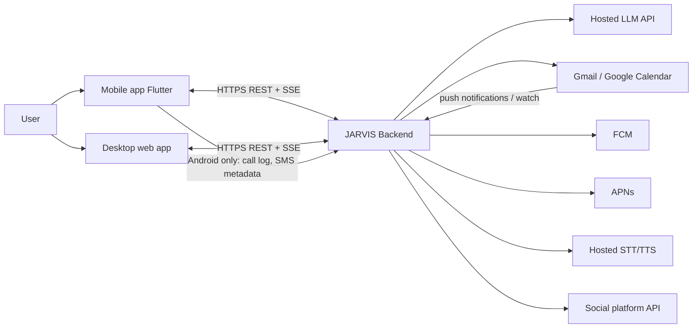
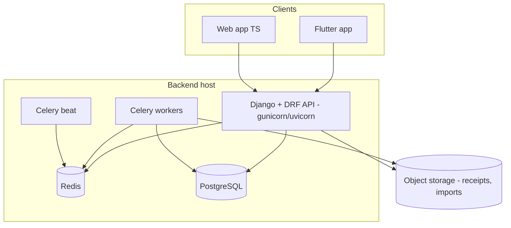
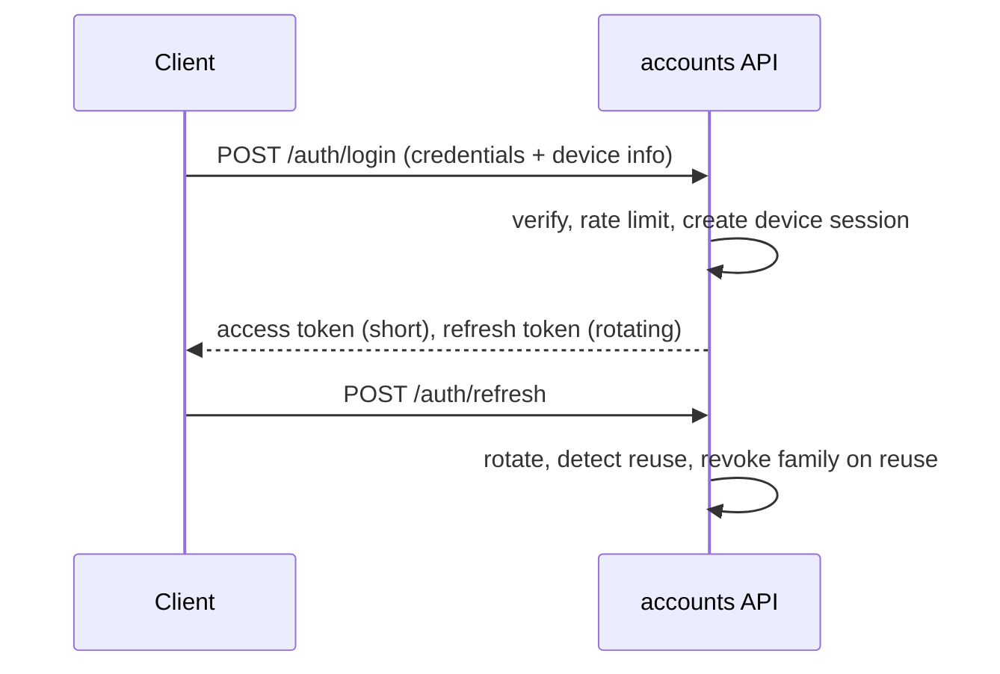
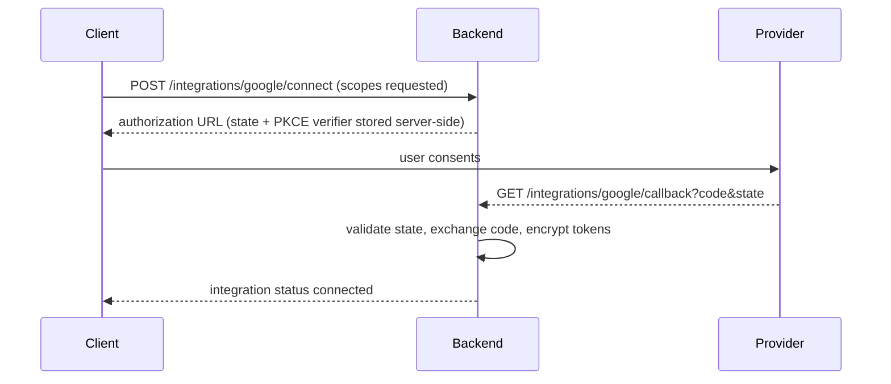
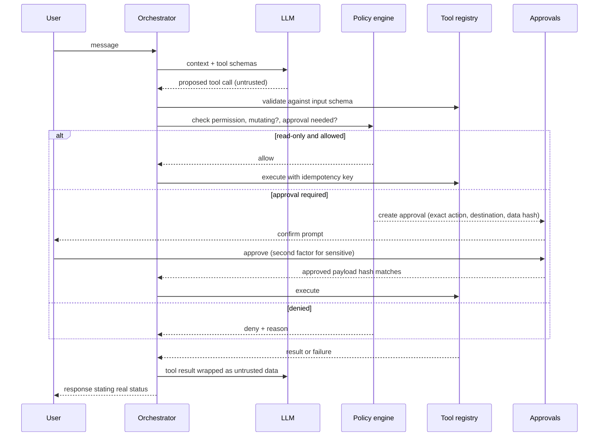
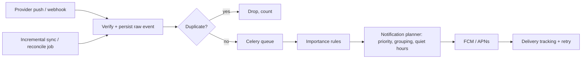

# 01 - Architecture

Date: 2026-10-20 | Status: Draft for review

## 1. Style

Modular monolith (Django), one deployable, separate Celery worker and beat processes from the same codebase. Clients are thin. Provider adapters sit behind interfaces so each external service is replaceable and mockable.

## 2. System context

## 3. Containers

## 4. Components (Django apps)

| App | Responsibility |
|---|---|
| common | Money type, crypto helpers, idempotency, pagination, error envelope, structured logging |
| accounts | Single-user auth, JWT access/refresh, MFA hooks |
| devices | Device registry, device sessions, push tokens |
| integrations | Provider adapters (Google first), OAuth flow, encrypted credentials, sync state |
| agent | Orchestrator, tool registry, policy engine, planner, LLM adapter, state machine |
| conversations | Conversations and messages, streaming |
| approvals | Pending approvals, confirmation payload hashing, expiry |
| mailbox | Email sync, classification, drafts, send tool |
| scheduling | Calendar sync, conflict detection, event tools (named to avoid stdlib `calendar`) |
| finance | Accounts, transactions, importers, dedup, categorization, deterministic reports |
| advisor | Recommendation engine over finance outputs |
| phonelog | Call and SMS metadata ingestion (Android collector), M-Pesa SMS parsing |
| dashboard | Read-only statistics aggregation APIs |
| events | Inbound event ingestion, dedup, importance rules, reconciliation |
| notifications | Preferences, quiet hours, grouping, FCM/APNs delivery, delivery tracking |
| social | Platform adapters, content calendar, approved publishing |
| memory | Preferences, approved facts, retrieval, retention |
| audit | Append-only audit log |
| workflows | Long-running agent tasks, steps, tool invocations, recovery |

Rule: views and serializers call `services/` (writes) and `selectors/` (reads). Business logic never lives in views.

## 5. Where things run

| Concern | Mobile | Desktop | Backend |
|---|---|---|---|
| UI, chat rendering | yes | yes | no |
| STT/TTS capture and playback | capture + playback | capture + playback | STT/TTS provider calls |
| Wake word (optional, later) | local, foreground only | local, while app runs | no |
| Call/SMS collection | Android only | no | storage + parsing |
| LLM calls, tools, policy | no | no | yes |
| Email/calendar/finance sync | no | no | yes |
| Push generation | receive only | receive only | yes |
| Native code needed | Android collector, push, foreground voice service | notifications, startup (Tauri later) | none |

## 6. Key flows

### 6.1 Authentication

### 6.2 OAuth connection

### 6.3 AI tool execution

### 6.4 Event processing

### 6.5 Notification delivery

Planner creates a `notification`, delivery workers create `notification_deliveries` per device, retry with exponential backoff and jitter, mark `failed_permanent` on invalid token. No delivery-time guarantee is promised.

### 6.6 Voice

Push-to-talk first: client records, sends audio chunks to backend STT, backend streams LLM text over SSE, client plays TTS (hosted audio or on-device TTS), user interrupt cancels the server stream. Sensitive actions require a tap confirmation; voice alone never approves.

### 6.7 Financial analysis

Importers -> normalize -> dedup (fingerprint) -> categorize (rules first, LLM suggestion only as unconfirmed suggestion) -> deterministic report calculators -> LLM explains computed numbers only. LLM never produces numbers that enter reports.

### 6.8 Failure recovery

Every workflow step is persisted before execution. On worker restart, a recovery task scans `workflows` in `running` with an expired lease: read-only steps are retried; mutating steps are resumed only if the idempotency key shows no completed effect, otherwise moved to `needs_review` and the user is told.

## 7. Trust boundaries

1. Client <-> Backend (TLS, token auth, device session).
2. Backend <-> LLM (outbound; prompts may contain personal data; minimize and redact).
3. Backend <-> providers (OAuth tokens, scoped).
4. Untrusted content (email, SMS, social messages, attachments) <-> agent context: wrapped as data, never instructions.
5. LLM output <-> tool execution: always schema-validated and policy-checked.

## 8. External dependencies

Hosted LLM, Google APIs, FCM, APNs, hosted STT/TTS, object storage, error tracking, one social API (later).

## 9. Top technical risks

| # | Risk | Mitigation |
|---|---|---|
| 1 | Call log and SMS access blocked or restricted on stores / unavailable on iOS | Android sideload, Android-only collector, documented limitation |
| 2 | No official personal M-Pesa API | SMS parsing + CSV import; verify Daraja scope; never use undocumented endpoints |
| 3 | Prompt injection via email/SMS/social content | Data wrapping, tool-level policy, no autonomous mutating tools, injection test suite |
| 4 | OAuth token leakage | Field-level encryption, key outside DB, least scopes, revoke flow |
| 5 | Duplicate side effects on retry | Idempotency keys on every mutating tool, unique constraints |
| 6 | Financial miscalculation | Integer minor units, pure-function calculators, property tests |
| 7 | Missed provider events | Reconciliation job with sync cursors |
| 8 | LLM cost and latency growth | Token budgets, caching, small-model routing, per-task cost tracking |
| 9 | Provider API verification/approval delays (Google sensitive scopes, social apps) | Start approvals early; personal-use testing mode where allowed |
| 10 | Spoofed or forged financial SMS | Sender allowlist, format validation, mark parsed records `unverified` until reconciled |

## 10. Cost drivers

LLM tokens, hosted STT/TTS, hosting, error tracking, social API tiers (verify at Phase 13). No numbers are quoted here because pricing must be verified from official pages.
