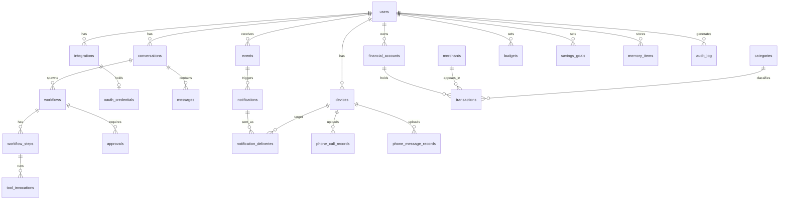

# 05 - Database Schema

Date: 2026-10-20 | Status: Draft for review | Engine: PostgreSQL

## 1. Conventions

- PK: `id uuid` (v4). Timestamps `timestamptz` UTC. `created_at`, `updated_at` on every table.
- `owner_id uuid FK users(id)` on every user-data table; all unique constraints and indexes lead with `owner_id` where relevant.
- Money: `amount_minor bigint` + `currency char(3)`; never float or numeric for stored amounts.
- Encrypted columns marked (enc) are stored as bytea ciphertext with key id.
- Soft delete only where history matters (transactions, memory); hard delete on user request for privacy-driven purges.
- Enums as `varchar` with CHECK constraints (easier migrations than PG enums).

## 2. ER overview

## 3. Tables

### Identity and devices

| Table | Columns | Keys / constraints | Indexes |
|---|---|---|---|
| users | id, email (unique), password_hash, timezone, default_currency, is_active, mfa_enabled | unique(email) | - |
| devices | id, owner_id, platform (android/ios/web/desktop), name, push_token (enc), push_provider, app_version, last_seen_at, revoked_at | | (owner_id, revoked_at) |
| refresh_tokens | id, owner_id, device_id, family_id, token_hash, expires_at, used_at, revoked_at | unique(token_hash) | (family_id), (device_id) |
| idempotency_keys | id, owner_id, key, endpoint, request_hash, response_status, response_body, expires_at | unique(owner_id, endpoint, key) | (expires_at) |

### Integrations

| Table | Columns | Keys / constraints | Indexes |
|---|---|---|---|
| integrations | id, owner_id, provider (google/microsoft/linkedin/...), kind (mail/calendar/social), status (connected/revoked/error), granted_scopes (jsonb), external_account_id, sync_cursor, last_synced_at, last_error | unique(owner_id, provider, kind, external_account_id) | (owner_id, status) |
| oauth_credentials | id, integration_id (unique FK), access_token (enc), refresh_token (enc), expires_at, key_id | unique(integration_id) | - |

### Conversations and agent

| Table | Columns | Keys / constraints | Indexes |
|---|---|---|---|
| conversations | id, owner_id, title, archived_at | | (owner_id, updated_at desc) |
| messages | id, owner_id, conversation_id, role (user/assistant/system_note), content, source (text/voice), status, token_usage (jsonb) | FK conversation | (conversation_id, created_at) |
| workflows | id, owner_id, conversation_id, goal, state, lease_expires_at, cancel_requested_at, cost_minor, error | CHECK state in table | (owner_id, state), (state, lease_expires_at) |
| workflow_steps | id, workflow_id, seq, tool_name, args (jsonb), state, started_at, finished_at | unique(workflow_id, seq) | |
| tool_invocations | id, owner_id, step_id, tool_name, idempotency_key, args_hash, status, result (jsonb), error, attempts | unique(owner_id, tool_name, idempotency_key) | (step_id) |
| approvals | id, owner_id, workflow_id, step_id, tool_name, action_payload (jsonb), payload_sha256, destination_summary, state (pending/approved/rejected/expired/consumed), expires_at, decided_at, decided_via_device_id, decision_factor | | (owner_id, state, expires_at) |

### Events and notifications

| Table | Columns | Keys / constraints | Indexes |
|---|---|---|---|
| events | id, owner_id, source (gmail/calendar/finance/phone/social/system), external_event_id, type, payload (jsonb, minimal), importance, processed_at, status | unique(owner_id, source, external_event_id) | (owner_id, status, created_at) |
| notifications | id, owner_id, event_id null, category, priority, title, body, group_key, state, suppressed_reason, scheduled_for | | (owner_id, created_at desc), (group_key) |
| notification_deliveries | id, notification_id, device_id, provider, status (queued/sent/failed_retry/failed_permanent/delivered_ack), attempts, last_error, sent_at | unique(notification_id, device_id) | (status) |
| notification_preferences | id, owner_id, category, integration_kind, enabled, min_priority, quiet_hours (jsonb) | unique(owner_id, category, integration_kind) | |

### Finance

| Table | Columns | Keys / constraints | Indexes |
|---|---|---|---|
| financial_accounts | id, owner_id, name, type (mpesa/bank/cash/card/other), currency, reported_balance_minor, reported_balance_at, include_in_spend | unique(owner_id, name) | |
| merchants | id, owner_id, name, normalized_name, default_category_id | unique(owner_id, normalized_name) | |
| categories | id, owner_id, name, parent_id, essential (bool) | unique(owner_id, name) | |
| import_batches | id, owner_id, account_id, source (csv/xlsx/sms/manual/api), file_ref, status, rows_total, rows_imported, rows_duplicate, rows_rejected, report (jsonb) | | (owner_id, created_at) |
| transactions | id, owner_id, account_id, batch_id, posted_at, amount_minor (signed), currency, kind, description, merchant_id, category_id, category_source (rule/manual/llm_suggested), provider_ref, fingerprint, verification (verified/unverified), counterparty_account_id null, deleted_at | unique(owner_id, account_id, fingerprint) | (owner_id, posted_at desc), (owner_id, merchant_id, posted_at), (owner_id, category_id, posted_at), (owner_id, kind, posted_at) |
| raw_sms_records | id, owner_id, device_id, sender, body (enc), received_at, parse_status (parsed/unparsed/rejected), transaction_id null | unique(device_id, source_record_id) | |
| budgets | id, owner_id, category_id, period (monthly), limit_minor, currency, active_from, active_to | unique(owner_id, category_id, active_from) | |
| savings_goals | id, owner_id, name, target_minor, currency, target_date, linked_account_id | | |
| recurring_expenses | id, owner_id, merchant_id, expected_minor, cadence, next_due, detected_by (manual/auto), confirmed | | (owner_id, next_due) |
| obligations | id, owner_id, name, amount_minor, due_day, essential | | |
| receipts | id, owner_id, transaction_id null, object_key, extracted (jsonb), extraction_status | | |
| accounting_policies | id, owner_id, treat_transfers_as_spend (bool default false), fee_treatment | unique(owner_id) | |
| financial_reports | id, owner_id, period_start, period_end, currency, definition_version, payload (jsonb), generated_at | | (owner_id, period_start) |
| recommendations | id, owner_id, kind, payload (jsonb: data, assumptions, impact, tradeoffs, confidence), state (new/accepted/rejected/expired), outcome (jsonb) | | (owner_id, state) |

Income records and expense records are not separate tables: they are transactions filtered by `kind`. This avoids duplicated data and double counting.

### Phone activity and mailbox/calendar metadata

| Table | Columns | Keys / constraints | Indexes |
|---|---|---|---|
| phone_call_records | id, owner_id, device_id, source_record_id, direction (incoming/outgoing/missed/rejected), started_at, duration_seconds, counterpart (enc), counterpart_hash, contact_name (enc, nullable) | unique(device_id, source_record_id) | (owner_id, started_at desc), (owner_id, direction, started_at) |
| phone_message_records | id, owner_id, device_id, source_record_id, direction, occurred_at, counterpart_hash, length_chars | unique(device_id, source_record_id) | (owner_id, occurred_at desc) |
| phone_collection_settings | id, owner_id, device_id, enabled, paused_at, retention_days | unique(owner_id, device_id) | |
| mail_messages | id, owner_id, integration_id, provider_message_id, thread_id, received_at, from_hash, subject (enc), labels (jsonb), is_unread, is_important, needs_reply, classification (jsonb) | unique(integration_id, provider_message_id) | (owner_id, received_at desc), (owner_id, is_unread) |
| calendar_events | id, owner_id, integration_id, provider_event_id, starts_at, ends_at, timezone, title (enc), status, recurrence_ref | unique(integration_id, provider_event_id) | (owner_id, starts_at) |

Email bodies are not stored by default; they are fetched on demand from Gmail and passed to the agent as untrusted data. Only metadata and classification results are cached.

### Memory, social, audit

| Table | Columns | Keys / constraints | Indexes |
|---|---|---|---|
| memory_items | id, owner_id, kind (preference/fact/workflow), key, value (jsonb), origin (user_stated/user_confirmed/model_proposed), confirmed_at, expires_at, deleted_at | unique(owner_id, kind, key) where deleted_at is null | |
| social_posts | id, owner_id, integration_id, state (draft/approved/scheduled/published/failed), content, scheduled_for, external_post_id, idempotency_key | unique(owner_id, idempotency_key) | |
| audit_log | id, owner_id, actor (user/agent/system), action, target_type, target_id, device_id, ip, detail (jsonb), occurred_at | append-only | (owner_id, occurred_at desc), (action) |

## 4. Data ownership

- Every row belongs to one `owner_id`. Selectors and a DRF permission class enforce it. Tests create two owners and assert cross-access returns 404.
- Provider data remains authoritative at the provider; local copies are caches or minimal metadata with a documented reason.

## 5. Retention (defaults, configurable)

| Data | Default |
|---|---|
| phone_call_records / phone_message_records detail | 90 days; daily aggregates kept |
| raw_sms_records | 12 months |
| events | 90 days |
| notification_deliveries | 90 days |
| tool_invocations, workflows | 12 months |
| audit_log | 24 months |
| memory_items | until deleted or expires_at |
| transactions | until user deletes |

Purge jobs run via Celery beat and write audit entries.

## 6. Migration strategy

Django migrations only; one migration per logical change; no data and schema change in the same migration; reversible where feasible; CI runs `makemigrations --check` and applies migrations to an empty DB and to a seeded snapshot. Audit-log append-only rule applied by a DB role without UPDATE/DELETE grants (Phase 2).
